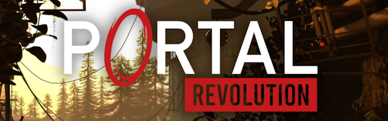

<div align="center">
  <p>
    <a align="center">
      </a>
  </p>
</div>

#  Portal Revolution VR Mod - **CURRENTLY NOT WORKING!**

# *** HELP NEEDED! ***

This Repo is intended as a **starting point** for implementation of a VR Mod for Portal Revolution. Feel free to contribute!


## Things that work
* The mod is loaded as a slim `d3d11.dll` wrapper (no dxvk anymore; OpenVR takes D3D11 textures directly)
* Hooks into D3D11 (device, swap chain, render targets), OpenVR is initialized

## Things that need fixing
* Update Source-SDK related files (x64, Strata Source)
* Re-establish hooks into game engine

## Build instructions
1. Clone Repository
2. Open l4d2vr.sln, set to x64 (Debug, Release or RelWithDebInfo), build

Note: After building, it will attempt to copy the new ```d3d11.dll``` to your ```Portal Revolution/bin/win64``` directory.

## How to use
* Copy the contents of ```L4D2VR``` (```config.txt```, ```manifest.vrmanifest```, ```SteamVRActionManifest```) and ```thirdparty/openvr/bin/win64/openvr_api.dll``` to ```Portal Revolution/VR/```
* The mod sets the required launch options itself.

## Based on
* Brilliant Portal 2 VR mod from [Gistix](https://github.com/Gistix/portal2vr)
* Portal Reloaded adaptions from [Scriptor25](https://github.com/Scriptor25)
* [l4d2vr](https://github.com/sd805/l4d2vr)
  
## Utilizes code from
* [VirtualFortress2](https://github.com/PinkMilkProductions/VirtualFortress2)
* [gmcl_openvr](https://github.com/Planimeter/gmcl_openvr/)
* [source-sdk-2013](https://github.com/ValveSoftware/source-sdk-2013/)

## Third-party licenses
* [MinHook](https://github.com/TsudaKageyu/minhook): Copyright (C) 2009-2017 Tsuda Kageyu; Hacker Disassembler Engine: Copyright (c) 2008-2009 Vyacheslav Patkov. BSD 2-Clause License, see [thirdparty/minhook/LICENSE.txt](thirdparty/minhook/LICENSE.txt).
* [OpenVR](https://github.com/ValveSoftware/openvr): Copyright (c) 2015, Valve Corporation. BSD 3-Clause License, see [thirdparty/openvr/LICENSE](thirdparty/openvr/LICENSE).
